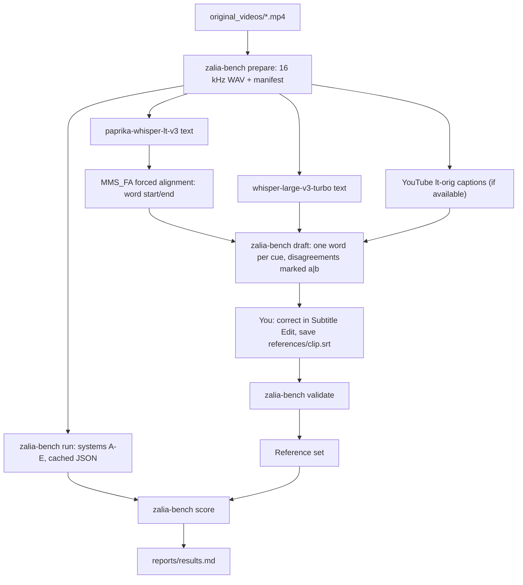

# Lithuanian Word-Level ASR Benchmark: Implementation Plan

## Goal

Build a small, reproducible benchmark that measures **ASR text accuracy** and **word-level timing accuracy** on Lithuanian speech. It covers 5 short videos (~7.4 min total). The benchmark scores ASR only. Profanity detection is out of scope.

Workflow:
1. Local models produce a strong draft (one word per SRT cue).
2. You correct text and timings in **Subtitle Edit**, a free Windows app that shows the waveform and lets you drag SRT cue edges.
3. A scorer compares any ASR system against your corrected reference and prints a results table.

This replaces judging timing by eye in a video player with numbers you can track over time.

### Facts from research

| Item | Finding |
|---|---|
| Clip durations | kiesa 96.5 s, Hermanas 192.8 s, Obage 48.2 s, Sinkevičius 48.2 s, Socdemai 60.1 s → **446 s total** |
| Audio start offsets | All `start_time = 0.000` (no A/V offset problems) |
| YouTube auto-captions | **Available** in Lithuanian (`lt-orig`, json3 format with per-word start offsets) for `HHVlfKFXQws` (Hermanas) and `UpM7O4GAdlI` (Socdemai). The other 3 filenames have no YouTube ID. |
| `yt-dlp` | Installed (2026.08.19) |
| MMS forced aligner | `torchaudio.pipelines.MMS_FA`: multilingual CTC aligner, Latin a–z input, 20 ms frames. Lithuanian works once diacritics are stripped for alignment only (`ė→e`, `š→s`). |
| **Torch install problem** | `uv.lock` resolves `torch` from PyPI (CPU build), not the CUDA index. This is why `uv run` started downloading torch earlier. Any `uv sync` / `uv run` would replace your CUDA torch with the CPU build. This must be fixed first. |

---

## What else to consider (beyond "draft → correct")

These are ranked by how badly each one would hurt the benchmark if ignored.

1. **Anchoring bias (most important).** When you correct a draft, you tend to accept boundaries and words that sound "close enough". The system that made the draft then gets an unfairly good score.
   - Mitigation A: generate the text draft from **two models**. Words where they disagree are marked `paprika|turbo`, so your attention goes to the uncertain spots.
   - Mitigation B, a calibration clip: annotate the 48 s Sinkevičius clip a second time **from scratch, without the draft**, a few days later. Comparing the two versions measures your annotation noise plus anchoring bias. Do not try to "improve" a system by less than that amount.
2. **Written annotation rules before you start.** Without fixed rules, boundaries drift between clips. Examples: where does a word starting with *p/t/k* begin? What about fillers, cut-off words, or overlapping speakers? I'll write a 1-page `GUIDELINES.md`.
3. **Report tolerances, not just averages.** At ±20 ms your own precision is the limit. "% of words within 50 ms / 100 ms" and **signed bias** (systematically early vs. late) are more trustworthy than mean absolute error.
4. **Measure the problem you actually saw.** Add a *pause bleed* metric: the share of reference silence (gaps ≥150 ms) that hypothesis words wrongly cover. This directly quantifies the "words hanging over pauses" complaint.
5. **Cache raw ASR output.** ASR takes minutes; scoring takes milliseconds. Store each system's raw output once. Then you can iterate on timestamp post-processing (acoustic trimming, padding) instantly, without rerunning the model.
6. **Same audio for everyone.** Annotate and evaluate on the identical 16 kHz WAV that the pipeline uses.
7. **Subtitle Edit gotcha.** Never run *Tools → Fix common errors*. It merges and extends short cues, which would destroy one-word-per-cue timing.
8. **Copyright.** The source media stays gitignored. The reference transcripts are derived from YouTube content. Committing them to a public repo is a small risk, and the decision is yours (see Open Questions).
9. **Dataset size honesty.** About 750–800 words (my estimate, from Hermanas' 1.7 words/s) is enough to compare systems and catch big timing errors. It is **not** enough to claim a general Lithuanian WER. Differences under ~1–2 % WER are noise at this size.

---

## User Review Required

> [!IMPORTANT]
> **Effort estimate (my guess, not measured):** 3–5 hours to correct ~750–800 words with full start/end timing, plus ~1 hour for the calibration clip. Hermanas (193 s) alone is about 40 % of the work.

> [!WARNING]
> **Downloads on slow internet:** `openai/whisper-large-v3-turbo` (~1.6 GB) for the second-model draft, and MMS_FA weights (roughly 1 GB, approximate). Both are one-time downloads.

> [!WARNING]
> **pyproject change:** I will pin `torch` and `torchaudio` to the PyTorch CUDA 12.4 index, so `uv sync` stops replacing your GPU build. This modifies `pyproject.toml` and `uv.lock`.

---

## Open Questions

> [!IMPORTANT]
> 1. **YouTube links for the other 3 videos** (Obage, Sinkevičius, kiesa)? If they are on YouTube, I'll add their auto-captions as a free extra system. If not, YouTube is scored on Hermanas and Socdemai only.
> 2. **Is `kiesa - 500 litu` a song/rap over music?** If yes, I recommend keeping it but reporting it in a separate row. Singing over music is a different difficulty class, and it would skew the averages.
> 3. **Commit the corrected reference SRTs to the public GitHub repo?** Recommended: yes (they are small text and make the benchmark reproducible), but it is your call given the copyright note.

---

## Workflow



---

## Proposed Changes

### 1. Environment fix and dependencies

#### [MODIFY] pyproject.toml
```diff
+[project.optional-dependencies]
+bench = [
+    "torchaudio==2.6.0",
+    "jiwer>=3.0",
+]
+
+[tool.uv.sources]
+torch = [{ index = "pytorch-cu124" }]
+torchaudio = [{ index = "pytorch-cu124" }]
+
+[[tool.uv.index]]
+name = "pytorch-cu124"
+url = "https://download.pytorch.org/whl/cu124"
+explicit = true
 
 [project.scripts]
 zalia-ruta = "zalia_ruta.cli:main"
+zalia-bench = "zalia_ruta.bench.cli:main"
```
- `yt-dlp` is called as an external command (already installed). It is not pinned, because old versions break when YouTube changes.

#### [MODIFY] .gitignore
```diff
+benchmark/audio/
+benchmark/drafts/
+benchmark/hyp/
```

---

### 2. Benchmark data layout

```text
benchmark/
├── manifest.json        # clip_id, source file, youtube_id, duration, sha256 of WAV   (committed)
├── GUIDELINES.md        # annotation rules                                              (committed)
├── audio/<id>.wav       # 16 kHz mono, same decode as pipeline                          (ignored)
├── drafts/<id>.draft.srt                                                                (ignored)
├── references/<id>.srt  # YOUR corrected ground truth                                   (Open Q3)
├── hyp/<system>/<id>.json  # cached raw ASR outputs                                     (ignored)
└── reports/results.md   # score table                                                   (committed)
```
Clip IDs: `hermanas`, `socdemai`, `sinkevicius`, `obage`, `kiesa`.

#### [NEW] benchmark/GUIDELINES.md (key rules)
- **Verbatim text**, as spoken. Slang is spelled as heard (`blėt`, `bleit`). Numbers are written as spoken words (`penki šimtai`).
- **Word start** = first audible or visible energy of the word. For an initial *p/t/k/b/d/g* after silence, start at the **burst**, because the closure is silent.
- **Word end** = last audible energy, including trailing *s/š/t* friction or burst.
- **Linked words with no pause**: put the boundary at the clearest spectral change. **Do not invent gaps**, and **do not fill real gaps**.
- **Markers** (plain text, safe in SRT):
  - `~ee`, `~mm` = filler. Excluded from WER and timing.
  - `pir-` = cut-off word. Excluded from WER.
  - `???` = unintelligible. Timed, excluded from WER.
  - `#SKIP` cue = region excluded from all metrics (overlapping speakers, music-only, laughter).
- **Zoom**: work at a ~1–2 s waveform window. Target precision is ±20 ms.
- Resolve every `a|b` disagreement marker. The validator rejects any leftover `|`.

---

### 3. Benchmark code: `src/zalia_ruta/bench/`

#### [NEW] bench/srt_io.py
Parses and writes word-per-cue SRT files. Reuses `format_srt_timestamp` from [subtitles.py](file:///c:/Users/zabit/Documents/GitHub/zalia-ruta/src/zalia_ruta/subtitles.py).

#### [NEW] bench/mms_align.py
Forced alignment of known text onto audio:
```python
bundle = torchaudio.pipelines.MMS_FA
model = bundle.get_model(with_star=False).to(device)
# per pause-aligned chunk (reuses chunker.find_pause_cuts):
emission, _ = model(waveform_chunk)
tokens = tokenizer([strip_diacritics(w).lower() for w in words])
spans = aligner(emission[0], tokens)        # per-word token spans, 20 ms frames
start = spans[0].start * 0.02 + chunk_offset
end   = spans[-1].end  * 0.02 + chunk_offset
```
The original Lithuanian spelling is kept for output. Diacritics are stripped only for the aligner tokens.

#### [NEW] bench/youtube.py
Fetches `lt-orig` json3 auto-captions via `yt-dlp --skip-download --write-auto-subs --sub-langs lt-orig --sub-format json3`. It parses per-word `tStartMs + tOffsetMs` start times. YouTube provides **no end times**, so this system is scored on start times and WER only.

#### [NEW] bench/systems.py
Runs each system on `audio/<id>.wav` and caches the output to `hyp/<system>/<id>.json`:

| ID | System | Timing source |
|---|---|---|
| A | `paprika_raw` | HF pipeline word timestamps (no trimming) |
| B | `paprika_refined` | Current production: HF plus `acoustic_refine_words` |
| C | `paprika_mmsfa` | Paprika text plus MMS_FA alignment |
| D | `turbo_raw` | whisper-large-v3-turbo, HF word timestamps |
| E | `youtube_auto` | YouTube lt-orig captions (start only, where available) |

A and B share one ASR run. B is recomputed from cached raw output, so trimming changes are scored instantly.

#### [NEW] bench/draft.py
Builds `drafts/<id>.draft.srt`. Text comes from paprika, and timing comes from MMS_FA (system C, likely the most accurate, so the least correction work). The script aligns paprika's words against turbo's and YouTube's words with an edit-distance alignment. Where they disagree, the cue text becomes `paprika|turbo[|youtube]`.

> [!NOTE]
> The C draft timing means system C has an anchoring advantage. The calibration clip (from-scratch Sinkevičius) measures how big that advantage is.

#### [NEW] bench/validate.py
Rejects a reference if it contains: leftover `|`, overlapping cues, `start >= end`, non-monotonic order, cues beyond clip duration, or empty text. It reports the line numbers of all errors.

#### [NEW] bench/score.py
- **Normalization:** lowercase and strip punctuation. Fillers, `???`, cut-off words, and `#SKIP` regions are removed from both reference and hypothesis.
- **Text:** WER, CER (diacritics kept), and diacritic-insensitive WER (via `jiwer`).
- **Timing** (on correctly matched words from the edit-distance alignment):
  - start/end absolute error: median, mean, P90
  - **% within 25 / 50 / 100 ms**
  - **signed bias** (negative = early)
  - **pause bleed %**: hypothesis word time inside reference gaps ≥150 ms, divided by total reference gap time
- **Output:** `reports/results.md`, per clip plus a pooled row. Music clips get a separate row (Open Q2).

Example output:

| System | WER | CER | Start med (ms) | End med (ms) | ≤50 ms | End bias (ms) | Pause bleed |
|---|---|---|---|---|---|---|---|
| A paprika_raw | … | … | … | … | … | … | … |

#### [NEW] bench/cli.py (`zalia-bench`)
```text
zalia-bench prepare              # extract WAVs, write manifest, fetch YouTube captions
zalia-bench run [--system X]     # run/cache systems A–E
zalia-bench draft                # write drafts/<id>.draft.srt
zalia-bench validate             # check references/*.srt
zalia-bench score                # write reports/results.md
```

---

### 4. Tests

#### [NEW] tests/test_bench_srt.py
- SRT round trip.
- Validator catches overlaps, leftover `|`, and out-of-order cues.

#### [NEW] tests/test_bench_score.py
Synthetic reference/hypothesis pairs with known answers:
- 1 substitution in 10 words → WER 0.10
- every end shifted +40 ms → end bias +40, 100 % within 50 ms
- a hypothesis word spanning a 500 ms reference gap → correct pause bleed
- fillers and `#SKIP` regions are excluded

#### [NEW] tests/test_bench_youtube.py
json3 parsing on a small checked-in fixture: absolute word starts computed from `tStartMs + tOffsetMs`.

---

## Your Annotation Steps (after code is ready)

1. Install **Subtitle Edit** (free, nikse.dk).
2. Open `benchmark/drafts/<id>.draft.srt`, then *Video → Open video file* and select `benchmark/audio/<id>.wav`. The waveform and spectrogram appear.
3. Correct the text, resolve `a|b` markers, and drag cue edges on the waveform.
4. *File → Save as* `benchmark/references/<id>.srt`. Run `zalia-bench validate`.
5. Suggested order: Sinkevičius (short, clean, good for learning the tool), then Socdemai, Obage, kiesa, and Hermanas last.
6. A few days later, annotate Sinkevičius **from scratch** as `references/sinkevicius.blind.srt` (calibration).

---

## Verification Plan

### Automated Tests
```powershell
.venv\Scripts\pytest
```
All existing 14 tests plus the new bench tests must pass.

### Environment Check
```powershell
uv sync --extra bench
.venv\Scripts\python -c "import torch, torchaudio; print(torch.__version__, torchaudio.__version__, torch.cuda.is_available())"
```
Expected output: `2.6.0+cu124 2.6.0+cu124 True`

### End-to-End Smoke Test
1. Run `zalia-bench prepare` and `zalia-bench run` on Sinkevičius only.
2. Run `zalia-bench draft` and confirm that the draft opens in Subtitle Edit with the waveform.
3. Score the **uncorrected draft** as a temporary reference against systems A–D. The scorer must run end to end, and system C must score near-perfect timing against its own draft (sanity check).

### Manual Verification
- You confirm the Subtitle Edit workflow is comfortable on one clip before annotating the rest.
- After all references exist: review `reports/results.md`, and compare `sinkevicius.srt` against `sinkevicius.blind.srt` to get the noise floor.
