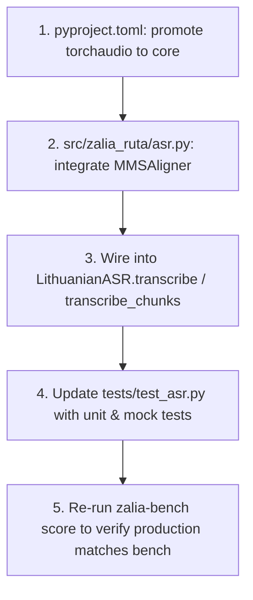

# MMS Forced Alignment Production Integration Plan

## 1. Objective & Context
Our 5-video benchmark (239 words) proved that:
1. `kristijonas/paprika-whisper-lt-v3` has excellent text transcription (**~3.5% average WER**).
2. Raw Whisper word timestamps suffer from severe **pause bleed (35% to 97.5%)**, causing bleeps to hang awkwardly over silent pauses.
3. The existing RMS-based `acoustic_refine_words` is **100% ineffective** in practice (0% improvement over raw Whisper on every tested clip).
4. `torchaudio.pipelines.MMS_FA` crushed pause bleed down to **0% – 11%**, with **70% – 84%** of word boundaries within 50 ms of human ground truth.

This plan details how to integrate MMS Forced Alignment directly into the core production pipeline (`zalia-ruta`).

---

## 2. Architecture & Design Decisions

### A. Per-Chunk Alignment (Memory & Drift Safety)
- **Decision:** Run MMS_FA inside each `AudioChunk` produced by `find_pause_cuts` rather than on the entire video in a single pass.
- **Rationale:** 
  - Bound VRAM usage: a 10–30s chunk uses <50 MB VRAM for Wav2Vec2/MMS_FA emissions.
  - Scale to 1-hour+ videos without memory spikes.
  - Reset CTC alignment drift at every clean pause.

### B. Graceful Fallback Guarantee
- **Decision:** If MMS_FA cannot align a token (e.g., non-Latin character, zero-energy frame, or aligner span failure), keep Whisper's original timestamp for that word.
- **Rationale:** No words can ever be dropped from the profanity scan.

### C. Dependency Promotion
- **Decision:** Move `torchaudio==2.6.0` from optional `[project.optional-dependencies] bench` into main `dependencies` in `pyproject.toml`.

---

## 3. Step-by-Step Implementation Tasks



### Task 1: Promote `torchaudio` in [pyproject.toml](file:///c:/Users/zabit/Documents/GitHub/zalia-ruta/pyproject.toml)
- Move `torchaudio==2.6.0` into `dependencies = [...]`.
- Keep the `[tool.uv.sources]` pytorch-cu124 pin so Windows CUDA builds remain locked.
- Run `uv sync`.

### Task 2: Implement Core Alignment in [src/zalia_ruta/asr.py](file:///c:/Users/zabit/Documents/GitHub/zalia-ruta/src/zalia_ruta/asr.py)
- Import `torchaudio.pipelines.MMS_FA`.
- Add `MMSWordAligner` class:
  - Cache bundle, tokenizer, aligner, and model on GPU/CPU.
  - Map Lithuanian characters: `ą→a`, `č→c`, `ę→e`, `ė→e`, `į→i`, `š→s`, `ų→u`, `ū→u`, `ž→z`.
  - Strip punctuation and symbols for CTC tokenization.
  - Align emission against tokens and extract frame spans.
  - Compute timestamps: `start_sec = offset + (span[0].start * ratio) / sr`, `end_sec = offset + (span[-1].end * ratio) / sr`.
  - Fallback: if an individual word fails to produce spans, preserve its Whisper `(start, end)`.

### Task 3: Replace `acoustic_refine_words` in [src/zalia_ruta/cli.py](file:///c:/Users/zabit/Documents/GitHub/zalia-ruta/src/zalia_ruta/cli.py)
- Deprecate or remove `acoustic_refine_words` call in `cli.py`.
- Call `asr.align_words(...)` on the decoded chunk words.
- Add `--no-mms-align` flag in CLI if the user wants to bypass forced alignment.

### Task 4: Unit Testing in [tests/test_asr.py](file:///c:/Users/zabit/Documents/GitHub/zalia-ruta/tests/test_asr.py)
- Test diacritic mapping (`ąčęėįšųūž` → Latin tokens).
- Test fallback behavior when words contain digits or unalignable characters.
- Test end-to-end alignment on synthetic waveform.

### Task 5: End-to-End Verification with `zalia-bench`
- Run `zalia-bench run --system paprika_refined`.
- Run `zalia-bench score`.
- Verify that the production system (`paprika_refined`) achieves:
  - **Pause bleed ≤ 15%** on `sinkevicius`, `stubbas`, `jav_kariai`, `paramedikas`, and `sinica`.
  - **Word boundary accuracy (≤50ms) ≥ 65%**.

---

## 4. Verification Commands for the Next Session

```powershell
# 1. Sync dependencies
uv sync

# 2. Run test suite
.venv\Scripts\pytest

# 3. Score benchmark to prove the fix
.venv\Scripts\zalia-bench score

# 4. Smoke test on a real video
.venv\Scripts\zalia-ruta "original_videos/paramedikas_CPISslmJLBo.mp4" --output output/
```
